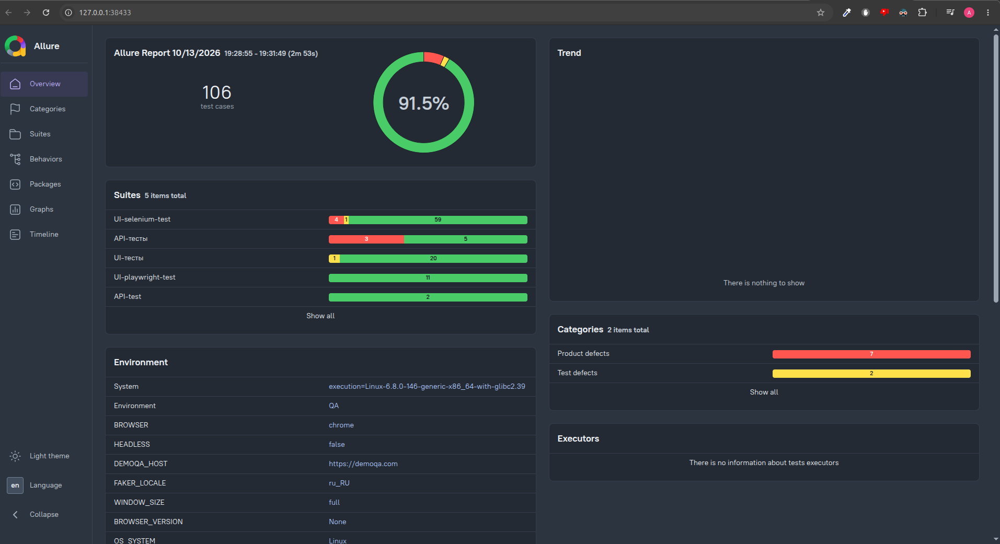

# DEMOQA Tests

Автотесты для учебного сайта [DEMOQA](https://demoqa.com): UI (Selenium и Playwright) и API (`requests`). Отчёты строятся в Allure.

## Стек

- Python, [Poetry](https://python-poetry.org/)
- pytest, pytest-xdist (параллельный запуск)
- Selenium, Playwright
- requests (API-клиент)
- Allure Report
- Faker (тестовые данные)

## Структура проекта

```
.
├── src/
│   ├── api/demoqa/          # API-клиент и API-request-test
│   └── ui/demoqa/
│       └── selenium/       # страницы, локаторы и UI-selenium-test на Selenium
├── img/                    # картинки для README
├── conftest.py             # общие фикстуры
├── pytest.ini              # настройки pytest и маркеры
└── pyproject.toml          # зависимости
```

## Быстрый старт

### 1. Требования

- Python 3.10+ (точную версию смотри в `pyproject.toml`)
- Poetry
- Браузер Google Chrome (драйвер Selenium скачивает сам)
- Allure CLI для просмотра отчётов ([установка](https://allurereport.org/docs/install/))

### 2. Установка зависимостей

```bash
poetry install
poetry run playwright install chromium
```

Если Chrome не установлен (Linux, Debian/Ubuntu):

```bash
wget https://dl.google.com/linux/direct/google-chrome-stable_current_amd64.deb
sudo apt install -y ./google-chrome-stable_current_amd64.deb
```

### 3. Переменные окружения

| Переменная    | Описание                | Пример              |
|---------------|-------------------------|---------------------|
| `DEMOQA_HOST` | Адрес тестируемого сайта | `https://demoqa.com` |

Linux / macOS:

```bash
export DEMOQA_HOST=https://demoqa.com
```

Windows (PowerShell):

```powershell
$env:DEMOQA_HOST = "https://demoqa.com"
```

## Запуск тестов

```bash
# все тесты
poetry run pytest

# только smoke
poetry run pytest -m smoke

# только API или только UI
poetry run pytest -m api
poetry run pytest -m ui

# параллельно: N воркеров, тесты одного файла идут в одном воркере
poetry run pytest -n 5 --dist=loadfile

# просмотр allure report
allure serve output/allure-results
```

> `--dist=loadfile` нужен, потому что часть тестов в одном файле зависит от общего состояния. Подбирать число воркеров (`-n`) лучше по числу ядер: `-n auto`.

### Маркеры

| Маркер       | Назначение                          |
|--------------|-------------------------------------|
| `smoke`      | быстрые критические проверки        |
| `regression` | полная регрессия                    |
| `api`        | API-request-test                           |
| `ui`         | UI-selenium-test                            |
| `e2e`        | сквозные сценарии                   |
| `db`         | проверки напрямую в базе            |
| `positive`   | позитивные сценарии                 |
| `negative`   | негативные сценарии                 |

Маркеры можно комбинировать: `pytest -m "ui and smoke and not negative"`.

## Allure-отчёт

Результаты прогона пишутся в `output/allure-results`. Открыть отчёт:

```bash
allure serve output/allure-results
```

Пример отчёта по Selenium-тестам:



## Планы

- [ ] Сохранять HAR-логи браузера при падении теста
- [ ] Запуск разных версий браузеров (например, через Docker)
- [ ] Настроить «Систему выполнения тестов» и диаграмму запусков в Allure
- [ ] Дописать UI-selenium-test для `book_store_application`
- [ ] Дописать UI-selenium-test для [`test_9_select_menu.py`](src/ui/demoqa/selenium/tests/widgets/test_9_select_menu.py)
- [ ] Изучить async и flaky-тесты
- [ ] Определить оптимальное число потоков для параллельного запуска